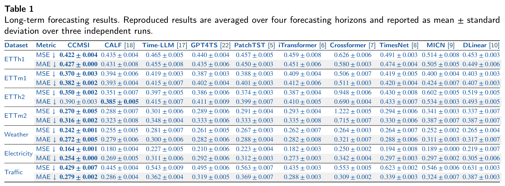
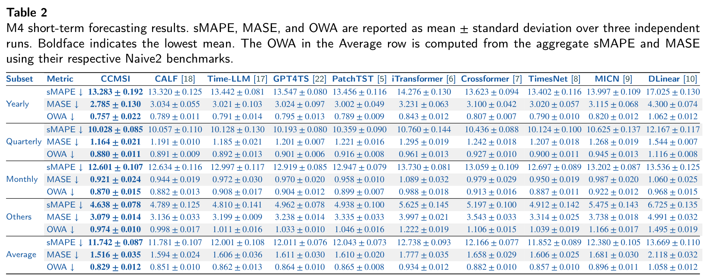

# CCMSI

## 1. 环境

### 环境初始化

在本目录执行：

```bash
conda env create -f environment.yml
conda activate ccmsi-reproduction
hf auth login
hf download EleutherAI/gpt-j-6b --local-dir weights/gpt-j-6b
hf download Qwen/Qwen2.5-7B --local-dir weights/Qwen2.5-7B
hf download meta-llama/Llama-2-7b-hf --local-dir weights/Llama-2-7b-hf
python scripts/prepare_gpt2.py
```

### Linux 启动环境

环境与依赖使用 `environment.yml`、`requirements.txt` 和 `requirements-verified.txt`。
环境名为 `ccmsi-reproduction`，Python 版本为 3.12.7。
启动脚本使用当前激活环境的 `python`，也可通过 `PYTHON` 环境变量指定解释器；不绑定个人安装路径，不自动创建环境或安装依赖。

### 参考硬件

以下为开发机器配置，不是运行所必需的硬件规格。

| 项目 | 配置 |
| --- | --- |
| CPU | 2 × Intel Xeon Platinum 8358 @ 2.60 GHz |
| CPU 核心 | 共 64 物理核心、128 逻辑线程 |
| 内存 | Linux 显示约 251 GiB |
| GPU | 4 × NVIDIA GeForce RTX 4090，编号 0–3 |
| 单卡显存 | 24564 MiB（约 24 GiB） |
| NVIDIA 驱动 | 570.211.01 |

## 2. 数据

在本目录执行以下命令，下载论文使用的全部数据集。ETT 命令一次下载 ETTh1、ETTh2、ETTm1、ETTm2：

```bash
python scripts/prepare_data.py --dataset ETT
python scripts/prepare_data.py --dataset Weather
python scripts/prepare_data.py --dataset Electricity
python scripts/prepare_data.py --dataset Traffic
python scripts/prepare_data.py --dataset M4
```

数据自动保存到对应的 `dataset/` 子目录；脚本记录下载源版本和文件 SHA-256，且不会覆盖已有文件。将 Naive2 压缩包解压为 `dataset/m4/submission-Naive2.csv`。数据来源与预处理见 [数据说明](docs/DATA.md)。

## 3. 任务与命令

| 实验 | 数据集 | 命令 |
| --- | --- | --- |
| 长期预测，H=96 | Traffic | `bash scripts/long_term_forecasting/Traffic_pl96.sh` |
| 长期预测，四长度均值 | Traffic | `bash scripts/long_term_forecasting/run_all.sh` |
| 短期预测 | M4 | `bash scripts/short_term_forecasting/M4.sh` |
| 低数据预测，10%/25%/50% | Traffic | `bash scripts/low_data_forecasting/run_all.sh` |
| GPT-2 模块消融 | Weather | `bash scripts/run_linux.sh run_batch.py --suite configs/suites/ablation.json` |


```bash
python run_experiment.py --config configs/long_term/Traffic_pl96.json
```

运行结果保存在 `results/`，使用输出的批次目录名汇总：

```bash
python aggregate_results.py --manifest results/batches/<batch_id>/manifest.json
```

### Linux 运行参数

```bash
CUDA_VISIBLE_DEVICES=0 bash scripts/long_term_forecasting/Traffic_pl96.sh --dry-run
```

## 4. 结果

### 长期预测参考结果



### M4 短期预测参考结果


